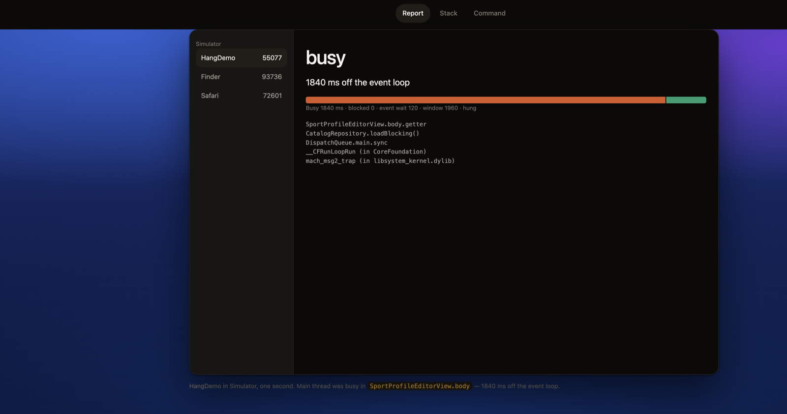

# Hangprobe

See why a Mac, Simulator, Android, or debug iOS app stopped answering.

Hangprobe samples the main thread. Time outside the UI event loop is the hang; the heaviest stack says whether the thread was `busy` on CPU or `blocked` on a lock.

Apple's hang floor is `250 ms`. An Android `ANR` is a separate `~5,000 ms` OS timeout and is labeled separately.

**MIT open source** — desk studio, CLI, MCP, inbox, gate, and device watchdogs. Every command is free. See [ADR 0003](docs/adr/0003-mit-open-source.md).

<p align="center">
  
</p>

<p align="center"><sub>HangDemo in Simulator — busy hang, App Focus stack, 1840 ms off the event loop.</sub></p>

## When to use it

1. **Simulator froze.** Select the app, press `⌘R` or run `hangprobe probe`. Exit code `1` if hung; the heaviest leaf says busy vs blocked.
2. **After the fix.** Probe again, then open Diff & Trend or run `hangprobe diff`. See whether `main_gap_ms` moved and which frames left.
3. **Agent or CI.** Wire `hangprobe mcp` (`probe_hang`) for agents, or `hangprobe gate` to fail a PR when the gap regresses.

`oss/` is a thin vendoring surface (HangprobeKit, Android watchdog, wire schema) with no HangprobeCore imports.

## Install

macOS 14+. One command (builds the CLI from source on your Mac):

```bash
curl -fsSL https://raw.githubusercontent.com/machugram/hangprobe/main/scripts/install.sh | bash
```

Homebrew (also builds from source — Gatekeeper-safe):

```bash
brew install --HEAD --formula https://raw.githubusercontent.com/machugram/hangprobe/main/Formula/hangprobe.rb
```

Or from a checkout:

```bash
swift build -c release --product hangprobe
cp .build/release/hangprobe /usr/local/bin/
swift run hangprobe ui
```

Optional desk app: `INSTALL_APP=1` with the install script, or `scripts/release-macos.sh`. Notarized downloads need a Developer ID Application certificate (`SIGN=1`).

## Commands

```bash
swift run hangprobe ui
swift run hangprobe probe Finder
swift run hangprobe mcp
swift run hangprobe watch Finder
swift run hangprobe worst Finder
swift run hangprobe diff Finder
swift run hangprobe import examples/sample-mxhang.json
swift run hangprobe appexit com.example.app
swift run hangprobe inbox --port 9481 --token "$HANGPROBE_INBOX_TOKEN" --dsym App.dSYM
swift run hangprobe gate Finder --max-gap-ms 250 --max-regression-ms 50
swift run hangprobe version

# Optional signed / universal artifacts → dist/release/<version>/
scripts/release-macos.sh
```

Privacy: [PRIVACY.md](PRIVACY.md).

Cursor MCP (after `hangprobe` is on `PATH`):

```json
{
  "mcpServers": {
    "hangprobe": {
      "command": "hangprobe",
      "args": ["mcp"]
    }
  }
}
```

Or from a checkout: `swift run --package-path . hangprobe mcp`.

## Architecture Decision Records

- [ADR 0001: Hang-First Mobile Diagnostics](docs/adr/0001-hang-first-mobile-apm.md)
- [ADR 0002: Borrow Android Mechanics & Desk-First macOS UX](docs/adr/0002-borrow-best-android-mechanics-and-desk-ux.md)
- [ADR 0003: Full MIT Open Source](docs/adr/0003-mit-open-source.md)

See [LICENSE](LICENSE).
